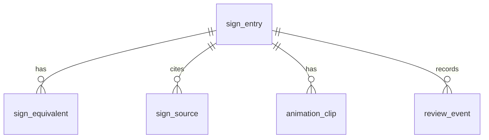
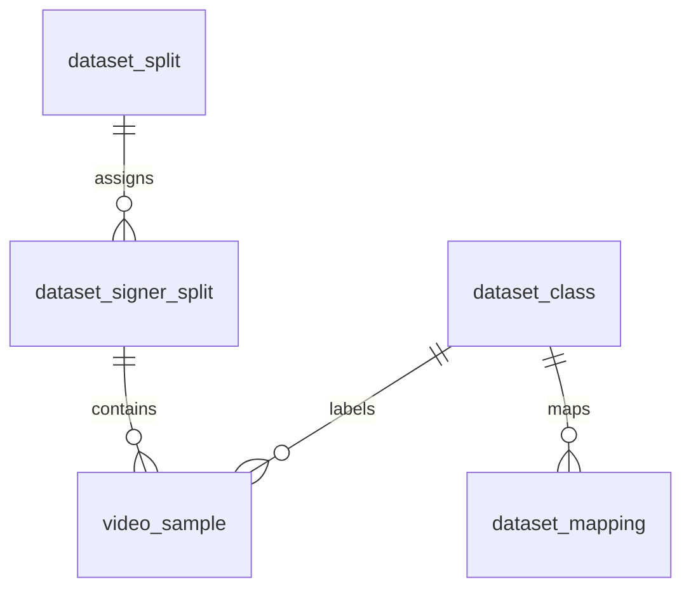
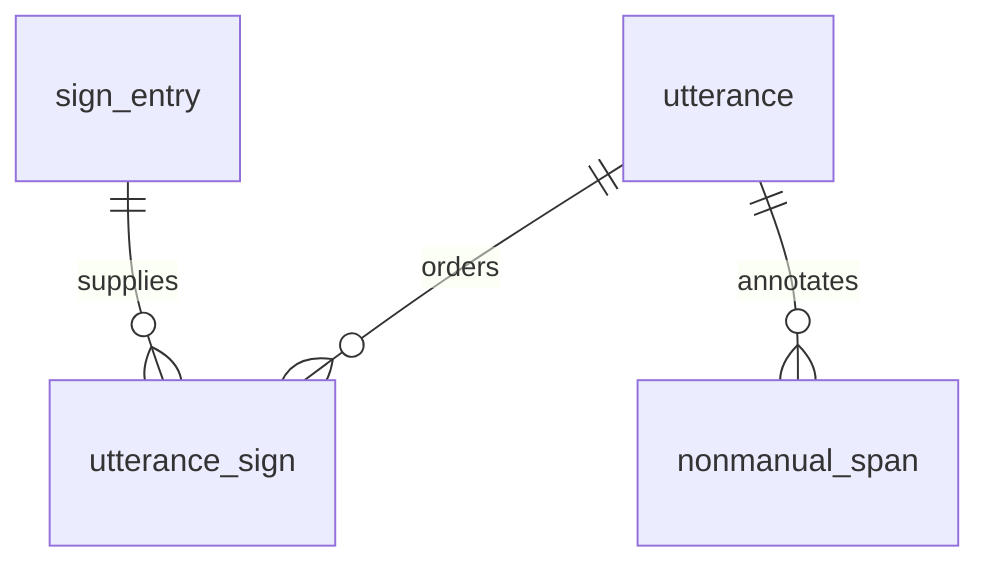

# SB-47 - Storage decision and schema implementation

**Owner:** Ceren Bilgenoğlu
**Recorded:** 21 November 2026, Türkiye time
**Jira:** [SB-47](https://el-dili.atlassian.net/browse/SB-47)
**Status:** Implementation prepared and locally tested; published on branch `SB-47`
with a PR targeting `main` (21 November 2026); team/independent review, checks
and merge pending. This is not a previously approved architecture decision or an
implemented full backend.

## 1. Decision implemented for review

Use **files plus a local SQLite metadata database**, preserving the **JSON
dictionary consumed by the application**. SQLite is the authoring/catalog
representation for this component; the reviewed lexicon can be exported to the
SoW's JSON representation. This does not change the product scope or replace the
browser JSON interface with a database connection.

| Information | Storage / boundary |
| --- | --- |
| Licensed AUTSL color/depth archives and extracted training videos | Private filesystem, outside git and outside database; retain original provider files/splits |
| Dataset release, original class labels/names, signer/split membership and paired sample paths/byte sizes | Private SQLite metadata catalog; actual ingestion belongs to SB-51 |
| Curated signs, equivalents, provenance, candidate mappings, clip paths and review history | SQLite authoring schema with explicit review states |
| Runtime lexicon | Deterministic JSON export with gloss, Turkish equivalents, definition, domain, variant, eligible clip path and review status |
| Offline training landmarks/model artifacts | External files managed by the later extraction/training work; no landmark arrays or model weights in this schema |
| Live camera/microphone input and live landmark sequences | No capture/retention tables and no live persistence in this component |
| Live user text, quick phrases, conversation logs, participant information | Not implemented/stored by SB-47; retention/access decisions stay open as recorded in the SoW |

The advisor's Sprint 3 review record, feedback item 6, says a database is not
required for training-only data, and records the team's plan to use videos as
files with MediaPipe. It also leaves the storage decision open. Accordingly,
SQLite is **not required by the advisor and is not needed to feed training
videos to MediaPipe**. It is selected here to implement SB-47's relational
lexicon/metadata requirement, support explicit mappings and reviews, and give
SB-51 a reproducible local target without provisioning a server. Separate
release records can catalog old/new snapshots; retaining their actual files,
permissions and backups remains an explicit operational responsibility, not
automatic continuous learning. Production DB technology remains a later
deployment decision if multi-user/concurrent write requirements justify it.

JSON/CSV-only files would be sufficient for a simple training-only workflow but
would require separate code for cross-record uniqueness, provenance and review
relations. A server database would add provisioning and credentials without a
documented current deployment requirement. Neither alternative is claimed to
have been benchmarked. The SQLite choice awaits team review in the SB-47 PR.

## 2. SoW alignment checked before finalizing the implementation

Source: [main Confluence SoW](https://el-dili.atlassian.net/wiki/spaces/SIGNBRIDGE/pages/5046283),
**v16**, change note “Clarify D10 output I1 and label revised SoW submission copy
v3.0”, read 21 November 2026. This check concerns the current Confluence body,
not a newly performed comparison against the submitted PDF.

| SoW provision | Implementation consequence |
| --- | --- |
| §13, “Producing and updating the lexicon”: JSON links gloss, Turkish equivalents, domain and clip file | Keep a JSON exporter; do not silently substitute SQLite as the runtime file contract |
| §13, Table M-1: browser MediaPipe; backend gloss/text conversion; several service choices open | No backend framework/provider is selected or deployed by this issue |
| §13 recognition-model paragraph: offline training on existing datasets; reproducible extraction/data card; MediaPipe version/schema alignment | Preserve dataset release/class/split provenance; actual extraction/versioned landmark artifacts belong to SB-50 and training work |
| §5 out-of-scope list: RGB-D/Kinect-style or other non-RGB capture paths | Depth paths inventory the supplied offline archive only; they do not introduce live depth capture or a depth-dependent model requirement |
| §14.1, H-1: live raw camera video never leaves device and is not stored; live landmarks not stored under proposed design | Distinguish licensed offline source files from live user capture; do not add live recording or landmark-payload tables |
| §14.1 and H-3: quick-phrase storage, retention/access protections still open | Do not implement saved phrases or conversation retention under a lexicon-schema issue |
| O1 / A-1 criterion 1: signer-independent split, fixed vocabulary, test outcomes not used in selection | One signer assignment per dataset release; original labels preserved; no class-to-sign auto-confirmation |
| D14 supplies lexicon entries to D15/D16; ≥300-avatar-sign target belongs to D16 | Empty schema/tests do not count toward recognition or avatar vocabulary; no target/evaluation threshold is changed |
| §14 dataset terms and H-3 open rights questions | Real data, mapping exports and credentials stay private; rights notes record evidence, not an additional redistribution grant |

No particular SQLite/PostgreSQL/MySQL/MongoDB technology was specified in the
current SoW text inspected. The local SQLite choice is documented here as a new
reviewable implementation decision. The SoW itself was not edited.

## 3. SB-14 mapping and explicit implementation choices

Baseline: [SB-14 PDF](../SB-14_TID_Gloss_and_Lexicon_Schema_Design.pdf),
repository blob `f8d90240cd3558fba9f68f4562a7c030a1aa34aa`, 8 pages.
The [Confluence SB-14 summary](https://el-dili.atlassian.net/wiki/spaces/SIGNBRIDGE/pages/6586372)
is supplementary; the committed PDF's field-level specification was read.

| SB-14 design | SB-47 implementation / deviation |
| --- | --- |
| §4 lexical tables | All three tables retained; stable sign IDs, non-unique gloss, separate equivalents and source evidence |
| §5 mappings, clips and append-only review | All three tables retained; same-sign composite FKs, one confirmed mapping per provider class, one default clip per sign, atomic event-driven status changes |
| §6 utterances/tokens/spans | All three tables retained for curated examples only; positive contiguous append order, same-utterance endpoints, overlap allowed, edits invalidate verification |
| Empty utterances rejected in logical design | An empty **illustrative assembly record** is allowed until tokens are inserted; a verified empty utterance is rejected. This supports parent/child insertion without deferred application-specific commit hooks |
| SQL dialect left open | SQLite STRICT, minimum 3.37; logical BOOLEAN becomes INTEGER 0/1; DATE becomes validated ISO date TEXT, review timestamp becomes UTC `YYYY-MM-DDTHH:MM:SSZ` TEXT |
| §5.3 review history: `review_id` is the primary key | Add `event_sequence INTEGER PRIMARY KEY AUTOINCREMENT` as the physical primary key; retain `review_id` as `TEXT NOT NULL UNIQUE`. The append-only log needs a deterministic, increasing insertion order for the latest-event-wins rule, independent of review-ID text or timestamp ties. The sign/clip status guards select the latest event with `ORDER BY event_sequence DESC`, and `reviews_by_target` indexes that order. `review_id` remains the unique logical event identifier; `event_sequence` is not a claim about when the real-world review occurred. |
| Stable, non-reused IDs | Sign rows cannot be hard-deleted or renamed; `is_active=0` retires an ID. Added explicitly instead of relying on deletion discipline |
| Original dataset/version/class mapping | Add `dataset_release`, `dataset_class`, `dataset_split`, `dataset_signer_split`, `video_sample` because actual inventory/split metadata was not modelled in SB-14 |
| Candidate/confirmed mapping and reviewed evidence | Candidates may coexist; confirmation additionally requires recorded rights assessment and a checked, non-draft sign. It remains distinct from expert review |
| Unicode NFC and Turkish-aware casing are application logic | `normalize_turkish` helper; export rejects non-NFC/non-uppercase lexical data. SQL does not pretend default Turkish collation exists |
| JSON export contract in §7.1 | Implemented: records keyed by stable sign ID, sorted equivalents, eligible default clip only, unknown/ineligible clip is null in development; conservative production gate preserved |
| Examples are unverified drafts | Do not seed the twelve examples or any AUTSL classes. All executed tests use explicitly fabricated fixtures |

These are implementation decisions, not new claims that prior design examples
or linguistic mappings were validated. Tables/roles record evidence but cannot
authenticate a reviewer, establish licence rights, or judge TİD correctness.

## 4. Entity relationships

`dataset_release` anchors classes and splits; `dataset_mapping.sign_id` points to
`sign_entry`, with same-sign source evidence required.

This overview omits composite-key details; the migration is authoritative for
physical FK/unique constraints. One video sample row contains the color/depth
pair. A dataset label has its own identity and may have several candidate
curated sign mappings; vocabulary is not populated by guessing from label text.

## 5. Delivery, execution and evidence

- [SQL migration](../../backend/db/migrations/001_lexicon.sql)
- [Runner and JSON exporter](../../backend/db/db.py)
- [Run instructions and SB-51 import boundary](../../backend/db/README.md)
- [Behavioral tests](../../backend/db/tests/test_schema.py)
- [Validation record](SB-47_Validation.md)

The minimum-run commands use Python's standard library and a private database
path. Tests cover initial schema/empty catalog, rerun/drift/rollback behavior,
foreign keys, duplicate samples, signer-split isolation, original label text,
relative paths, review evidence, confirmed-mapping/default-clip uniqueness,
Turkish Unicode handling, spans and the JSON gate. No actual data was imported,
no videos decoded, no MediaPipe pipeline run and no model evaluated.

**Validation-run provenance.** The checked-in validation record documents the original Linux run on Python 3.12.14 / SQLite 3.53.1 (31 tests passed). The PR description reports a separate publication-time run on Python 3.13, and Yasmin's review of 22 November 2026 reports an independent temporary-environment run on Python 3.13.18 (31 tests passed). These are separate runs, not conflicting descriptions of one environment. The latter two are attributed reports; they do not replace the checked-in original record or establish a Windows run. Windows execution remains pending. The review does not constitute team/advisor acceptance of SQLite; record that decision's owner and date before SB-51 relies on the schema.

GitHub branch: **`SB-47`**, exact uppercase issue key, published with an
issue-referencing commit and a PR (title plus Jira link) targeting `main` on
21 November 2026. Historical note: an earlier publication attempt was blocked by
the GitHub integration's 403 permission error. No approval is claimed.
Independent teammate approval, applicable checks and merge
remain necessary before Done. The Confluence summary and Jira progress record
track the deliverable but do not replace that gate.

## 6. Sources and remaining decisions

1. [SB-47 acceptance criteria](https://el-dili.atlassian.net/browse/SB-47).
2. SB-14 committed PDF, §§4-7 and §9, source blob above.
3. Main Confluence SoW v16, §13, §14.1, H-1/H-3, D14 and criterion 1.
4. [Sprint 3 advisor feedback](https://el-dili.atlassian.net/wiki/spaces/SIGNBRIDGE/pages/23134209),
   v4, feedback 3/5/6: dependencies, preparation process and training-storage guidance.
5. SB-46 verification report and three aggregate evidence CSVs, documented in
   [its Confluence summary](https://el-dili.atlassian.net/wiki/spaces/SIGNBRIDGE/pages/32210945).
6. SQLite official documentation: [foreign keys](https://www.sqlite.org/foreignkeys.html),
   [STRICT tables](https://www.sqlite.org/stricttables.html),
   [partial unique indexes](https://www.sqlite.org/partialindex.html),
   [triggers](https://www.sqlite.org/lang_createtrigger.html), accessed 21 November 2026.

Open for review: accepting SQLite for the current local authoring/catalog step;
final deployment technology; actual source/rights assessments and qualified
reviewer availability; pinned dataset snapshot naming/media-root configuration;
actual SB-51 ingestion. The schema does not decide runtime text/quick-phrase
retention or change ethics/privacy policy. The advisor's guidance about
dependent work remains relevant: schema preparation can proceed independently
of SB-46 merge, while actual SB-51 import depends on both verified inputs and
the reviewed schema; this record does not reschedule the team's backlog.
